<!-- titlepage
title: When Can You Trust a Topological Visualization?
subtitle: A task-based evaluation of the Scikit-TDA ecosystem (ripser, persim) and KeplerMapper
short: When Can You Trust a Topological Visualization?
field: Course | Scientific Visualization — Evaluation of Visualization Systems
field: Author | Shourya Sarkar
field: Software evaluated | ripser 0.6.15 · persim 0.4.1 · kmapper 2.1.0 (Python 3.12)
field: Date | 28 October 2026
field: Code, data and verification | https://github.com/shouryasarkar713/when-can-you-trust-a-topological-visualization
status: Evidence labels used in the text: [M] measured or computed from saved result files; [I] interpretation; [E] documented external fact; [F] proposal for future work.
-->

<!-- toc -->

# When Can You Trust a Topological Visualization?

## 1. Summary

**Question.** A persistence diagram or a Mapper graph looks like a statement about the shape of data. This report asks when such a picture can be trusted, using the Scikit-TDA tools ripser, persim and KeplerMapper (`kmapper`) on data with known structure and on one real weather record. Five things are kept apart throughout: the true topology of the data; the persistent-homology (PH) evidence under a specific metric and filtration; the Mapper graph under a specific lens, cover, clustering rule and parameters; the appearance of a drawing; and the reader's interpretation of it.

**Studies.** Three core experiments: a 13-task capability and workflow audit (E1); a 24-cell Mapper parameter-sensitivity grid on an annulus and a figure-eight, with a no-loop blob as control (E2); and a structured inspection of 13 figures by a single observer (E3). Three extension studies: a case study on NOAA Global Summary of the Day (GSOD) observations from Central Park, New York, 2019–2024; a self-contained offline Mapper explorer; and resampling and leave-one-year-out analyses. Five control experiments (D1–D5) test specific alternative explanations of the Mapper and weather results.

**Findings.**

1. **Persistent homology.** The constructed loops give a dominant H1 class — a gap ratio r_k ≥ 7.35 — in all 60 annulus and figure-eight subsamples and in all 60 independent redraws (r_k ≥ 8.0); the no-loop blob never reaches r₁ = 3. Distances against an overlapping full-data reference understate sampling variability by a factor of about 1.4–1.8 (annulus, figure-eight).
2. **Mapper.** The structure of a Mapper graph depends on the cover (resolution and overlap) and on the clustering rule and its scale. With the default rule — KMeans with k = 2 in every cover interval — the annulus graph has no cycle in 13 of 30 subsamples and 20 of 30 independent redraws. With single-linkage clustering at 3 × the median five-nearest-neighbour distance it has exactly one cycle in 30/30 subsamples (connected in 29/30) and 30/30 redraws; at half that scale the graph fragments and the cycle is absent in 22/30 subsamples. The larger scale was chosen after the default result was known and only two scales were tried, so this is an existence demonstration, not a recommended setting. Whether a no-loop sample produces graph cycles also depends on the clusterer.
3. **Weather.** A sliding-window embedding of the daily temperature series shows a strong H1 persistence-gap cue (r₁ = 4.75–7.32) in all six tested configurations. Matched null controls built with the same embedding do not meet the dominance criterion r₁ ≥ 3: r₁ = 1.02–1.14 after removing two fitted annual harmonics (which account for 82.2 % of the variance of the standardized series) and r₁ = 1.01–1.22 for ten shuffled series. H1 classes remain in the null embeddings; what is absent is a dominant one under this criterion. The controls show that the cue depends on the annual harmonic structure and on temporal order in these tests; they do not show that the annual cycle is its only source, and they do not support any climatological conclusion.
4. **Capability audit.** The triad computes persistence, draws diagrams and distances, and builds Mapper graphs natively, while barcodes, data generators, graph statistics and any offline use of the interactive export require custom code or other packages (130 counted lines of glue). The stock KeplerMapper HTML export loads its scripts from content-delivery networks and draws no graph without network access.
5. **Offline explorer.** A single 0.57 MB HTML file displays 35 saved Mapper cells with provenance. In a cold-cache, network-disabled browser session it passed 222 checks covering every cell and export.
6. **Artifact inspection.** E3 is a single-observer inspection with an AI viewing aid, not a participant study. It identifies unlabeled H0/H1 colours, the essential H0 point, and noise-scale Mapper cycles as encodings that can mislead; it says nothing about how people read the figures.

**Scope of the conclusions.** The experiments use two-dimensional synthetic shapes, one lens (first principal component), one cover family, two clustering families, and one station-year record. No participant study, hypothesis test or confidence interval is reported, and no claim is made about the true topology of any dataset, about climate, or about the relative merit of Mapper and other dimension-reduction methods. The practical conclusion is conditional: a user should ask which representation carries a claim, examine how it depends on its parameters, and compare with a null that shares the construction.

**Contribution.** The packages already provide the persistent-homology computation, diagram distances and the Mapper construction. This work adds a reproducible known-answer evaluation of those outputs, custom indicators with stated limits (the gap ratio r_k and a membership-overlap indicator S), controls that separate the effects of cover, clusterer, sampling and temporal order, and an offline viewer for saved results. No new topological algorithm is claimed.

## 2. Research questions, scope and design

### 2.1 Research questions

- **RQ1 (workflow).** Which visualization-workflow tasks does the triad support natively, which need other packages, and which need custom code? → E1.
- **RQ2 (sensitivity).** How sensitive are KeplerMapper visualizations to cover resolution, overlap, and the clustering rule — enough to change the structural interpretation a user draws? → E2, controls D1, D3, D4, and the explorer.
- **RQ3 (what the artifacts communicate).** What structural information do persistence diagrams and Mapper graphs make visible for a predefined task set, and which ambiguities arise from parameters and rendering? → E3.
- **Extension questions.** Do the diagnostics reveal known structure in real station-scale weather data, and under which representation (weather study)? Can parameter dependence be made inspectable offline with provenance (explorer)? How do diagrams and graphs change when the *sample* changes rather than the parameters (resampling)?

### 2.2 Scope and exclusions

The study evaluates the three packages as a visualization workflow. It does not benchmark other TDA libraries: a comparison of ripser with GUDHI (Maria et al., 2014), a UMAP or t-SNE baseline, torus data and a scaling benchmark were considered and left out of scope. Consequently ripser's correctness is supported only by the known-answer signatures of the synthetic data, determinism, and the literature (Bauer, 2021), not by agreement with a second implementation.

## 3. System boundary and related work

### 3.1 System boundary

The evaluated system is the Scikit-TDA triad: **ripser 0.6.15** (Vietoris–Rips persistent homology; the Python binding of Bauer's C++ Ripser; Tralie, Saul & Bar-On, 2018), **persim 0.4.1** (diagram distances and plotting; Saul & Tralie, 2019) and **kmapper 2.1.0** (the Mapper algorithm; van Veen et al., 2019). At the time of the study these were the latest PyPI releases and installed as binary wheels on Python 3.12 for Linux and Windows. networkx 3.7 (graph statistics), scikit-learn 1.9.1 (lens and clustering), numpy 2.5.4, scipy 1.18.1 and matplotlib 3.11.2 are counted as external to the system. [E]

Two documented properties of the packages shape the design. The kmapper 2.1.0 HTML export loads D3 6.1.1, FileSaver 2.0.2 and a web font from content-delivery networks at view time, so it is not an offline artifact. ripser 0.6.15 does not export a plotting function (`plot_dgms` was already absent in version 0.3.2 and present in 0.2.7); persim provides `plot_diagrams`, and neither package draws barcodes. [E]

### 3.2 Related work and positioning

- **Persistent homology.** Edelsbrunner, Letscher & Zomorodian (2002) and Zomorodian & Carlsson (2005) introduced persistence and its computation; Cohen-Steiner, Edelsbrunner & Harer (2007) proved the stability theorem that makes diagram distances meaningful; Bauer (2021) describes Ripser. A persistence diagram records, for each homology class, the scale at which it appears and the scale at which it disappears; H0 classes are connected components (one never disappears), H1 classes are loops. *Persistence* is death minus birth. A long persistence is evidence of a feature at the chosen metric and filtration, not a proof about the unknown underlying space.
- **Mapper.** Singh, Mémoli & Carlsson (2007) introduced Mapper; Carrière & Oudot (2018) analyse the one-dimensional case and its stability; Carrière, Michel & Oudot (2018) treat statistical analysis and parameter selection; Brown et al. (2021) study convergence of random Mapper graphs. This theory explains why the placement of the cover relative to critical values of the lens changes which Reeb-graph features appear. It concerns the Mapper construction under perturbed data or filters, not the particular clustering rule used here, which matters for Section 5.3.
- **Mapper evaluation and exploration tools.** Sen, Singh & Tiwari (2026) propose a three-axis evaluation framework for Mapper (stability, cluster quality, topological shape preservation) on synthetic data and UCI Digits; only the abstract was consulted for this report, so general Mapper evaluation is treated as established work. Mapper Interactive (Zhou et al., 2021) is an interactive framework that recomputes Mapper on the fly; giotto-tda provides interactive Mapper plotting (Tauzin et al., 2021); Belchí et al. (2020) propose a numerical measure of the instability of Mapper-type algorithms; tda-mapper (Simi, 2025) is a further Python implementation with a recomputing interface; Sedlmair et al. (2014) give a conceptual framework for visual parameter-space analysis. LoCoMapper (Yan, Li & Wang, 2026) visualizes local structural uncertainty of Mapper under cover perturbations; its official program page describes only cover-parameter perturbations and is silent on input sampling.
- **Weather and topology.** Perea & Harer (2015) show that sliding-window embeddings of periodic signals have a prominent H1 class, and Perea, Deckard, Haase & Harer (2015) develop SW1PerS for periodicity scoring. Applications of TDA to weather data mostly work at reanalysis scale (Muszynski et al., 2019; Strommen et al., 2023).
- **Evaluation methodology.** Task- and scenario-based evaluation of visualizations is discussed by Lam et al. (2012) and Isenberg et al. (2013). Munzner (2009) gives the nested model (domain, abstraction, idiom, algorithm) with a named threat to validity at each level, which motivates the separation of data, PH, Mapper and drawing used here. Brehmer & Munzner (2013) give a task typology in which the E1 and E3 task lists could be expressed; the tasks were not mapped onto it. Nielsen (1992) supports the general point that a single inspector finds only part of the problems in an interface; it is cited by analogy for E3 and is not evidence about topological figures.

The contribution is therefore an evaluation: a reproducible, layered study of a current ecosystem; custom indicators with documented limits; controls that isolate cover, clusterer, sampling and temporal-order effects; and an offline viewer whose novelty is limited to a particular combination of features (saved results first, one file, no server or CDN, per-cell provenance). It is not claimed to be the first Mapper explorer.

## 4. Methods and definitions

### 4.1 Conventions

All parameters and seeds are stored in YAML configuration files. Resampling seeds follow `seed = 20261022 + offset[shape] + i` with offsets 0, 1000 and 2000 for the annulus, figure-eight and blob. Numerical results are written to files before any figure is rendered, and every figure is rendered from saved results. The raw GSOD files carry SHA-256 hashes recorded at acquisition. Thresholds are conventions and are labelled as such; negative results are reported.

### 4.2 Definitions

- **Persistence gap ratio.** For H1 persistences sorted in descending order p₁ ≥ p₂ ≥ …, r_k = p_k / p_{k+1}. The rank k is the number of loops *known from the synthetic construction* (annulus k = 1, figure-eight k = 2); for real data where it is unknown k = 1. "Dominant H1" means exactly r_k ≥ 3, a chosen operational convention and not a theorem; it carries no uncertainty statement. r_k is undefined (reported as `None`) when fewer than k + 1 persistences exist or p_{k+1} ≤ 0. Two behaviours that no data in this study triggers (ripser is called without a threshold, so H1 deaths are finite) are pinned by tests rather than handled specially: an infinite p_k over a finite p_{k+1} returns ∞, and inf/inf or NaN input returns NaN. r_k is unchanged when all persistences are multiplied by a constant, hence by the z-scoring used in the weather analysis, whereas raw persistence values are not.
- **Cyclomatic number.** E − V + C for the undirected Mapper graph with E edges, V nodes and C connected components: the number of independent graph cycles. A *graph* cycle is not a statement about loops in the *data*.
- **Membership-Jaccard indicator S.** For graphs with node membership sets N₁, N₂ and J(A, B) = |A ∩ B| / |A ∪ B|, S = ½ [mean over n ∈ N₁ of max over m ∈ N₂ of J(n, m) + the symmetric term]. S compares which points the nodes contain; it ignores edges and components; it matches greedily; it is not normalized for node count; 1 − S violates the triangle inequality (a unit-tested counterexample); and S = 1 does not imply identical graphs. For a 400-point subsample graph compared with a 500-point reference its attainable maximum is about 0.80 (the reference nodes restricted to the sampled points score a median 0.800, range 0.786–0.822). S is therefore an exploratory indicator: never a distance, never used across different cover resolutions, never the sole stability measure.
- **Bottleneck and Wasserstein distances.** persim computes them with the essential H0 class dropped. Bottleneck is a maximum over matched pairs (L∞); the Wasserstein distance used here is an order-1 sum with Euclidean ground metric. Their magnitudes are not interchangeable and H0 and H1 values are never pooled. A 400-point subsample has 399 finite H0 classes against 499 for the 500-point reference; unmatched short classes add transport cost and inflate the H0 Wasserstein value, and they shift the H0 bottleneck mildly as well (Section 8.2).

### 4.3 Guards used throughout

**(G1)** Distances against a reference that overlaps the subsample are descriptive resampling-stability quantities: not independent validation, not unbiased generalization, and their spread is a variability band, not a confidence set. **(G2)** A distance is a metric value, not a hypothesis test. **(G3)** S is exploratory. **(G4)** Mapper graph cycles are not automatically topological loops, and the absence of a cycle does not show the absence of a loop. **(G5)** A dominant H1 class in a sliding-window embedding is evidence of recurrent structure in the embedded series at the studied scale, not of a closed physical trajectory. **(G6)** A connected or fragmented graph is a property of the construction parameters, and a layout can hide components without changing the graph.
## 5. Core experiments (E1–E3) and the clusterer control

### 5.1 E1 — capability and workflow audit

The 13-task workflow was executed as a scripted pipeline on four seeded synthetic datasets (annulus, figure-eight, no-loop blob, three-blob control; n = 500 / 500 / 500 / 450). Each task is recorded with its support level and a path to the artifact that demonstrates it (`audit/capability_matrix.csv`). [M]

| Support level | Tasks |
|---|---|
| Native (the triad does it) | install (T01); persistent homology (T03); diagram plot (T04); bottleneck/Wasserstein (T06); matching plot (T07); static Mapper drawing via `draw_matplotlib` (T10, with a custom alternative layout) |
| Needs custom code | data generators (T02); H1 barcode (T05); reproduction harness (T12) |
| Combination with scikit-learn | Mapper with PCA lens and seeded KMeans (T08) |
| Needs an external package | node, edge and component counts via networkx (T09); the PCA baseline view (T13) |
| Native but not offline-capable | interactive HTML export (T11) |

The custom glue code that fills these gaps is 130 non-blank, non-comment source lines in `src/` (`audit/glue_code_accounting.json`; the counting rule is stated there). Three properties of the software matter for what follows. The kmapper HTML export loads D3, FileSaver and a web font from content-delivery networks and, in a cold-cache browser without network access, throws `d3 is not defined` and draws 0 nodes and 0 edges (Section 7.2). networkx is needed for component counts but is not a declared kmapper runtime dependency. The native static layout `draw_matplotlib(layout='kk')` places disconnected components in one frame without inter-component repulsion (bounding-box overlap 0.23 on the three-blob control and 0.036 on the figure-eight), which motivated a component-separated rendering that changes coordinates only. [M]

### 5.2 E2 — Mapper parameter sensitivity

Grid: `n_cubes` ∈ {5, 10, 15, 20} × `perc_overlap` ∈ {0.20, 0.35, 0.50} = 12 cells per shape, 24 in total, for the annulus and the figure-eight (n = 500, noise 0.05, seed 42); PCA-1 lens; `CubicalCover`; `KMeans(n_clusters=2, random_state=42, n_init=10)` in every cover interval; reference cell (10, 0.35) fixed in the configuration. A no-loop blob (n = 500, σ = 0.45) is run at two diagnostic cells only. [M]

| Reading | Annulus | Figure-eight |
|---|---|---|
| Node count | 2 × `n_cubes` in all 12 cells | 2 × `n_cubes` in all 12 cells |
| Reference cell (10, 0.35) | 20 nodes, 21 edges, 1 component, cyclomatic 2 | 20 nodes, 19 edges, 2 components, cyclomatic 1 |
| Cycle cue absent | `n_cubes` = 5 (tree, cyclomatic 0, all overlaps) | (5, 0.35) and (5, 0.50) |
| Fragmentation | (20, 0.20): 2 components | reference: 2 components; (20, 0.20): 4 components |
| Construction-consistent reading | (10, 0.35)–(10, 0.50) | (20, 0.50): connected, cyclomatic 2 |
| S against the reference | 0.449–1.000 | 0.457–1.000 |

The figure-eight contrast cell (20, 0.50) was chosen for presentation after the full grid had been measured; all 12 cells per shape are reported. The no-loop blob gives, at the reference cell, 20 nodes, 23 edges, 1 component, cyclomatic number 4 with a longest basis cycle of **6** nodes (mean 5.0), while its H1 diagram has top-three persistences 0.1396 / 0.0962 / 0.0924 and r₁ = **1.451**, with no dominant class. At (20, 0.20) it fragments into 6 components with cyclomatic number 5.

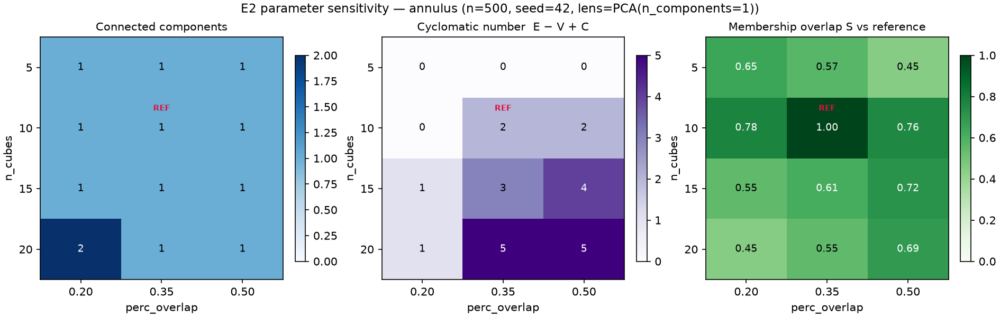

*Figure 5.1. E2 summary for the annulus (12 cells). Node count is 2 × `n_cubes` everywhere; the cycle cue (cyclomatic number) appears and disappears across the grid.*

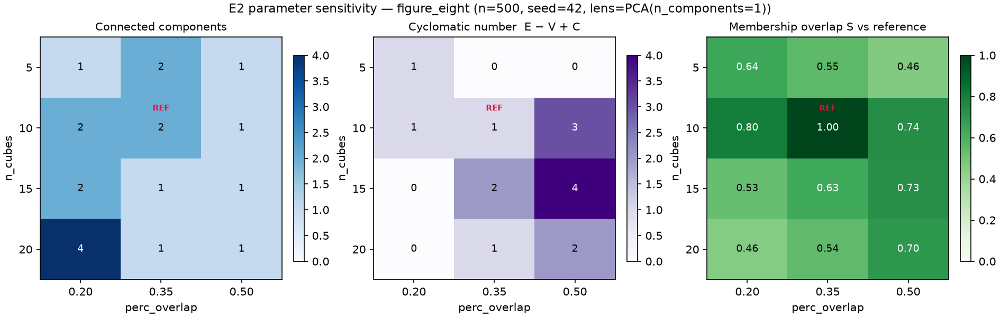

*Figure 5.2. The same summary for the figure-eight. The reference cell fragments into two components and (20, 0.20) into four, while (20, 0.50) gives the construction-consistent connected two-cycle reading.*

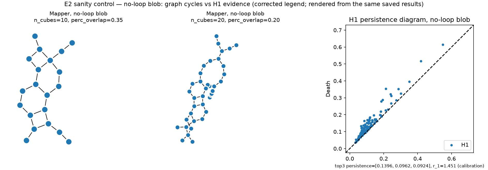

*Figure 5.3. The no-loop blob: Mapper graphs at two cells show cycles while the H1 diagram shows no dominant class.*

### 5.3 Control D1 — does the forced two-cluster rule drive the E2 pattern?

**Rationale.** `KMeans(n_clusters=2)` splits every cover interval that holds at least two points into two clusters, even where the preimage is a single connected piece. This is why the node count is exactly 2 × `n_cubes` in all 24 E2 cells and in all 90 resampled graphs: a mechanical consequence of k = 2, not a property of the data. It can also create or remove graph cycles regardless of the data. A study that holds the clusterer at a forced split cannot say whether cycle and fragmentation findings belong to Mapper or to that clustering rule.

**Design.** Same data, PCA-1 lens, 12-cell grid and reference cell; only the clusterer changes, to single-linkage agglomerative clustering cut at a distance ε = c × (median distance to the fifth nearest neighbour of the full cloud), with c ∈ {1.5, 3.0}. There is no per-shape tuning. The two multipliers were written into the configuration before the control was first run, but after the E2 results with the forced two-cluster rule were known, and only these two values were tried; they are an exploratory choice. [M]

| Shape, c | ε | Reference cell (nodes / components / cyclomatic) | Cells connected (of 12) | Cells with ≥ 1 cycle (of 12) | Node count = 2 × `n_cubes` |
|---|---|---|---|---|---|
| annulus, 3.0 | 0.308 | 17 / 1 / 1 | 10 | 11 | 0 cells |
| annulus, 1.5 | 0.154 | 27 / 3 / 1 | 0 | 8 | 0 cells |
| figure-eight, 3.0 | 0.177 | 13 / 1 / 2 | 12 | 8 | 0 cells |
| figure-eight, 1.5 | 0.089 | 29 / 5 / 0 | 0 | 0 | 0 cells |
| blob, 3.0 | 0.261 | 26 / 9 / 0 | 0 | 3 | 0 cells |
| blob, 1.5 | 0.130 | 79 / 36 / 0 | 0 | 2 | 0 cells |

**Findings.** (i) With the data-adaptive rule at the larger scale the figure-eight is connected in all 12 cells and shows two independent cycles at the reference cell, the construction-consistent reading, rather than the two components seen under forced two-way splitting; the annulus shows one cycle in 11 of 12 cells. (ii) The no-loop blob has far fewer cycles (cyclomatic 0 at the reference cell; at least one in 3 of 12 cells) but is split into 9–18 components; its cycles under the forced rule arise largely from two-way splits of sparse tails, and the scale-adaptive rule trades them for fragmentation. (iii) Halving the scale fragments every shape (3–11 components even for the annulus and the figure-eight) and removes the cycle cue from the figure-eight entirely. [M]

**Interpretation [I].** The E2 conclusion that reasonable parameter changes alter the structural story a Mapper graph tells stands, and the clusterer scale is one more such parameter, with an effect at least as large as that of cover resolution. The default-rule readings of the figure-eight (fragmented at the reference cell) and of the blob (noise cycles) are properties of this lens-cover-clusterer combination, not of Mapper in general. Graph cycles still do not certify loops, and whether a no-loop sample produces cycles depends on the clustering rule.

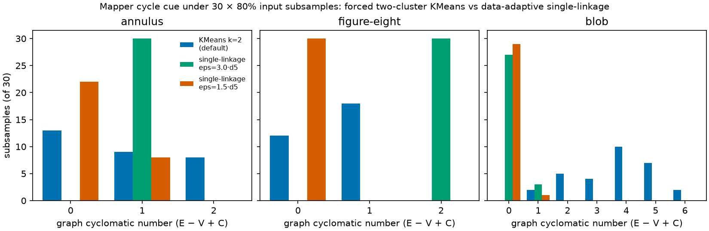

*Figure 5.4. Cyclomatic number of the Mapper graph over 30 subsamples (80 %) per shape for the forced two-cluster KMeans rule and for single-linkage at two scales (control D3; Section 8.3). The single-linkage scales were chosen after the KMeans result was known.*

### 5.4 E3 — single-observer artifact inspection

E3 was designed as a classroom pilot with 3–6 participants. **That study was not conducted**: a project constraint made any participant study impossible, no participant was recruited, and no participant data exist. The fallback specified in the design was executed instead. Thirteen stimuli (diagrams, Mapper graphs and scatter views, with neutral identifiers) were rendered from saved results. For each, the visible cues, an interpretation, an assessment category and the match with an expected property fixed from the data construction before the record was written were recorded (`e3_inspection/inspection_record.csv`). The record is the one authored artifact in the repository; `scripts/analyze_e3_inspection.py` validates it and computes counts only.

**Observer and AI assistance.** The inspection was performed by the author, who designed the datasets and had seen the E1 and E2 results, with an AI vision model used as a viewing aid under neutral prompts; the first unprimed description of each stimulus was recorded, and the final interpretation is the author's judgement. No blinding is claimed. The inspection therefore provides evidence about the artifacts — what the renderings communicate or fail to communicate — and about one invested reader's use of them with AI assistance. It provides no measure of human accuracy or population-level readability.

Of 13 records, 11 properties were clearly apparent and 2 ambiguous; the expected property matched fully in 12 and partially in 1. The ambiguous records concern encodings: the loop count of the figure-eight diagram depends on an unlabeled H0/H1 colour convention and on the essential H0 point, drawn on a dashed line farther from the diagonal than the loop points (the unprimed description answered "1" before settling on 2); and the blob's Mapper graph reads as "ring-like" because noise-scale cycles are visually indistinguishable from data-scale loops. Scatter views were uniformly clear.

## 6. Weather case study

### 6.1 Data and preprocessing

The study uses NOAA NCEI Global Summary of the Day (GSOD) daily observations for New York Central Park (station 72505394728 = USAF 725053 + WBAN 94728; 40.77898 N, −73.96925 E, 42.7 m), 1 January 2019 to 31 December 2024. The raw yearly CSV files come from the NCEI access directory; their SHA-256 hashes were recorded at acquisition, and a fresh download on 28 October 2026 was byte-identical. GSOD data are free for research and educational use with no warranty, and the product has no DOI. [E]

Independent parsing of the raw files gives 2192 rows (365 / 366 / 365 / 365 / 365 / 366 by year), 2192 distinct dates and a complete calendar. Missing-value codes: TEMP 0, DEWP 0, SLP 4 (9999.9), WDSP 125, GUST 911, SNDP 2119. Units were converted before any distance computation (°F → °C; mb ≡ hPa; knots → m s⁻¹; inches → mm) and no value was imputed. [M] Three data decisions shape the analysis:

- **Primary feature cloud = TEMP, DEWP, SLP.** Adding WDSP (a four-feature cloud) would require dropping 129 days (5.9 %), seasonally clustered: all of January–February 2019 plus 11 March days (70 consecutive days), and 55 further days (6 in January 2020, 33 in May–June 2020, 16 in September–October 2021). Three features lose 4 days (0.18 %: 2019-04-20, 2021-04-04, 2023-09-18, 2024-12-30), leaving **2188 days**, z-scored after dropping. The four-feature count is recorded, but no analysis was run on that cloud.
- **STP excluded.** 94.8 % of STP values are below 900 hPa (median 12.4 hPa) at a 42.7 m station. The cause is a lost leading digit (1012.4 appears as 012.4; SLP − (STP + 1000) has median ≈ 4.9 hPa, the hydrostatic expectation at this elevation). STP's missing-value code in these files is 999.9 (6 rows). STP is unused.
- **SLP = 999.9 on 2020-12-01** is also the wind-family code, but STP that day (994.7 hPa) plus ≈ 5 hPa corroborates a real reading; it is kept.

TEMP and DEWP are gapless over six years, so the seasonal series needs no interpolation.

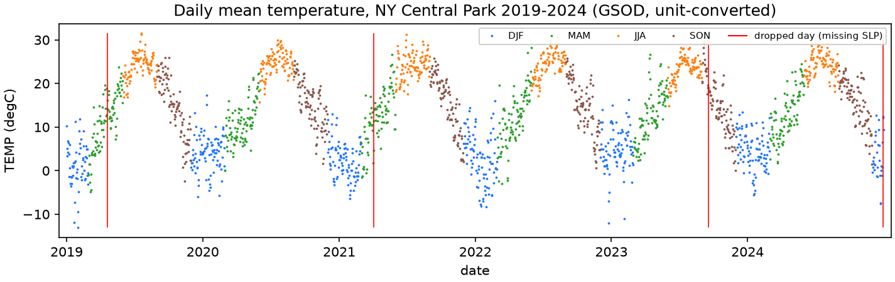

*Figure 6.1. The z-scored daily TEMP series, 2019–2024 (2192 days). It is the input to the sliding-window embedding of Section 6.3.*

### 6.2 PCA and Mapper on the static state cloud

On the z-scored TEMP/DEWP/SLP cloud, PC1 explains 69.0 % (TEMP and DEWP, negative SLP weight) and PC2 28.6 %, 97.6 % cumulatively: the three features are effectively two-dimensional. The Mapper grid ({5, 10, 15, 20} × {0.35, 0.50}, PCA-1 lens, KMeans k = 2, reference (10, 0.35)) was fixed before the outputs were inspected. [M]

| Cell | Nodes | Edges | Components | Cyclomatic | S vs ref |
|---|---|---|---|---|---|
| (5, 0.35) | 10 | 12 | 1 | 3 | 0.551 |
| (5, 0.50) | 10 | 13 | 1 | 4 | 0.445 |
| **(10, 0.35), reference** | 20 | 26 | 1 | 7 | 1.000 |
| (10, 0.50) | 20 | 27 | 1 | 8 | 0.685 |
| (15, 0.35) | 30 | 38 | 1 | 9 | 0.558 |
| (15, 0.50) | 30 | 40 | 1 | 11 | 0.665 |
| (20, 0.35) | 40 | 49 | **2** | 11 | 0.506 |
| (20, 0.50) | 40 | 52 | **2** | 14 | 0.666 |

Node count is 2 × `n_cubes` in all 8 cells, mechanically, because k = 2 (Section 5.3). The graph is connected for `n_cubes` ≤ 15 and splits in two at 20. With such high cyclomatic numbers the graph's cycles say little about loops in a three-dimensional cloud whose PH shows no dominant class (G4). A day-of-year lens variant (20 nodes, 27 edges, 1 component) encodes the calendar directly and appears only as a labelled comparison.

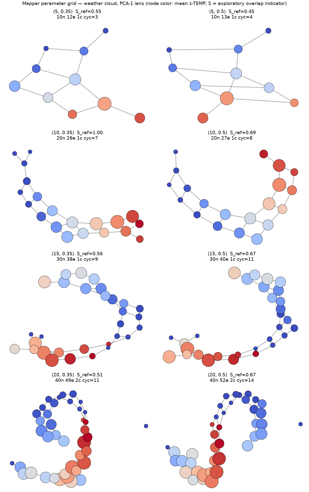

*Figure 6.2. The 8-cell weather Mapper grid (PCA-1 lens; node colour is mean z-TEMP). Fragmentation into two components appears at `n_cubes` = 20 under both overlaps.*

### 6.3 Seasonal sliding-window persistence

The embedding is a time-delay embedding of the z-scored daily TEMP series: point *i* = (x[i], x[i+τ], …, x[i+(d−1)τ]), span (d−1)τ days, stride 1, over all 2192 days. The series is gapless, so no window spans a gap and no incomplete window arises; z-scoring uses all 2192 days before windowing. Persistence is computed by ripser with `maxdim = 1` and the default threshold. [M]

| τ, d | Span (days) | Span / 365.25 | Points | Dominant H1 (z units) | r₁ |
|---|---|---|---|---|---|
| 30, 8 | 210 | 0.57 | 1982 | 1.998 | 5.62 |
| 45, 9 | 360 | 0.99 | 1832 | 2.571 | 7.32 |
| 52, 8 | 364 | 1.00 | 1828 | 2.039 | 4.92 |
| **60, 8 (reference)** | 420 | 1.15 | 1772 | 2.167 | 6.75 |
| 73, 6 | 365 | 1.00 | 1827 | 1.417 | 4.75 |
| 90, 8 | 630 | 1.72 | 1562 | 2.121 | 5.76 |

Each configuration has one H1 class that exceeds the next by a factor of 4.75–7.32 (r₁ ≥ 3, the stated convention). The six configurations use one dataset and bracket the annual period (five have spans between 210 and 630 days; the reference τ = 60, d = 8 comes from the study plan), so agreement across them is consistency, not independent replication. No record fixes the order in which the sweep was designed and analysed (Section 10.3). [I]

A seasonality check — FFT periodogram and autocorrelation of the same series — was computed after the sweep and played no role in choosing any parameter. Its dominant FFT bin has period 2192/6 = 365.3 days; the neighbouring bins correspond to 438 and 313 days, so the period carries a resolution of tens of days. That bin holds 82.1 % of the non-DC power. The autocorrelation peak within the search window [180, 550] days lies at lag 360 days (autocorrelation 0.676; at 365 days 0.673; at 182 days −0.746), but the peak is flat to within 0.06 over 340–375 days. The search window was set in the script written after the sweep.

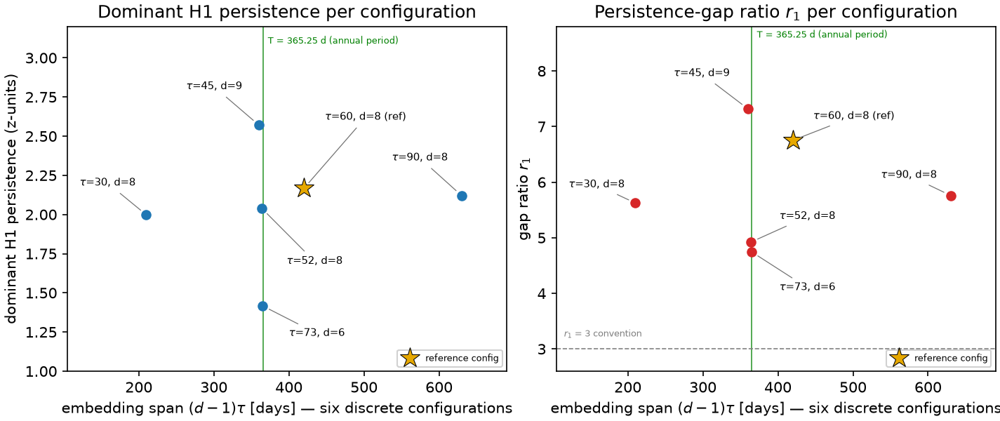

*Figure 6.3. The six-configuration sweep: dominant H1 persistence (left) and gap ratio r₁ (right) versus span in annual periods. Points are not connected because τ and d vary jointly across six discrete settings.*

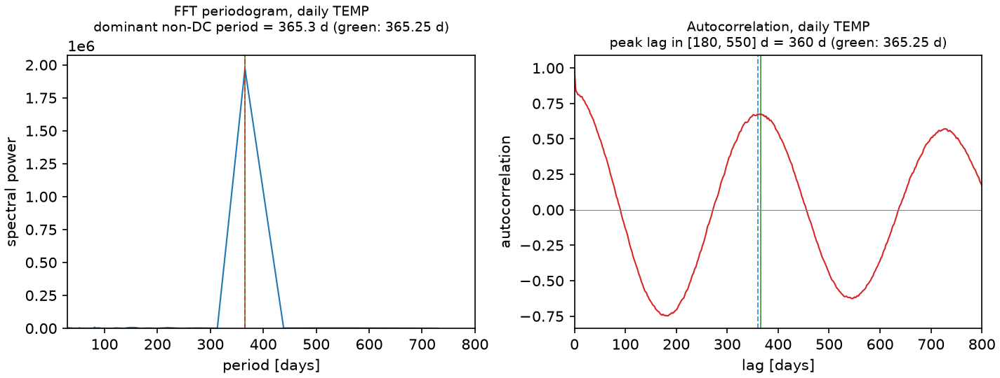

*Figure 6.4. FFT periodogram and autocorrelation of the z-scored daily TEMP series (descriptive; no embedding parameter was selected with it).*

**The static state-space cloud is not a null control.** Vietoris–Rips PH of the 3-D z-scored (TEMP, DEWP, SLP) cloud has 1049 H1 classes, dominant persistence 0.210 and r₁ = 1.19. The comparison with the temporal embedding is illustrative only: the persistence of a point cloud depends on the *set* of points, so permuting the day order leaves it unchanged and it cannot register temporal recurrence; it also differs from the embedding in dimension (3 against 8), variable set and density (median nearest-neighbour spacing about 0.105 against about 0.63 for the (60, 8) embedding). The exact statement is: in the tested temporal embedding a dominant H1 class appears, whereas the static 3-D cloud of three of the same observation fields has none. Matched controls follow in Section 6.4.

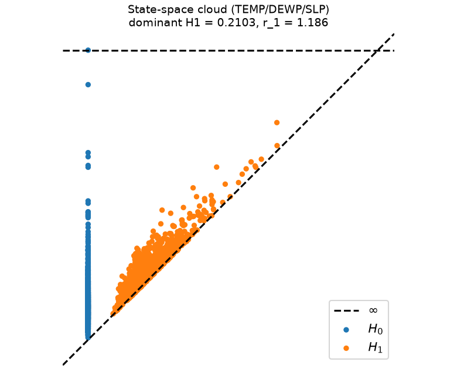

*Figure 6.5. Static 3-D state-space cloud: no dominant H1 class (r₁ = 1.19). A different object from the temporal embedding, shown for illustration and not as a null control.*

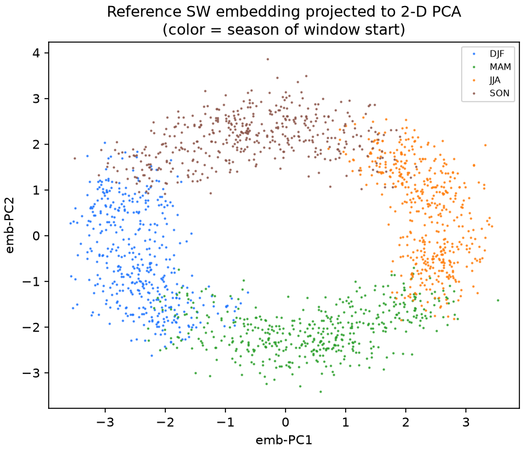

*Figure 6.6. 2-D PCA projection of the reference 8-D sliding-window embedding: a closed band with a hole, seasons progressing around it. The quantitative evidence is the persistence diagram; the projection is a drawing of it.*

### 6.4 Matched null controls remove the dominant H1 cue (control D2)

**Construction.** The controls use the same embedding code, ripser call and six (τ, d) configurations as Section 6.3, applied to (a) an *anomaly series*: the z-scored TEMP series minus a least-squares fit of an intercept and two annual harmonic pairs (periods 365.25 and 182.6 days), re-z-scored; and (b) ten *shuffled series*: random permutations of the z-scored TEMP values (seeds 20261028 + i), which keep the marginal distribution and destroy temporal order, for the reference configuration only because of cost. Processing the unmodified series with this code reproduces the saved sweep exactly (all six r₁ and dominant persistences; the z-scored array matches the saved one with maximum difference 0). [M]

| τ, d | r₁, TEMP series | r₁, anomaly series | Dominant H1, TEMP | Dominant H1, anomaly |
|---|---|---|---|---|
| 30, 8 | 5.625 | 1.138 | 1.998 | 0.685 |
| 45, 9 | 7.319 | 1.023 | 2.571 | 0.703 |
| 52, 8 | 4.922 | 1.035 | 2.039 | 0.506 |
| 60, 8 | 6.753 | 1.077 | 2.167 | 0.636 |
| 73, 6 | 4.745 | 1.025 | 1.417 | 0.573 |
| 90, 8 | 5.761 | 1.034 | 2.121 | 0.765 |

The two fitted harmonic pairs explain 82.2 % of the variance of the z-scored series. After their removal r₁ lies between 1.02 and 1.14 in every configuration. The ten shuffled series give r₁ between 1.007 and 1.219 (median 1.06) and dominant persistence 0.58–0.65; none reaches r₁ = 3. [M]

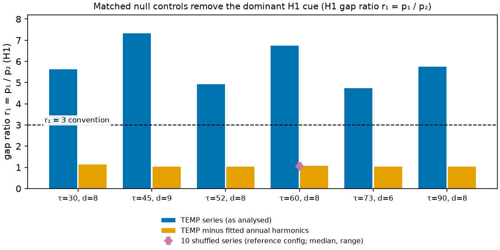

*Figure 6.7. H1 gap ratio r₁ for the six embedding configurations for the TEMP series, the anomaly series with two annual harmonics removed, and ten shuffled series (reference configuration; median and range). The dashed line is the r₁ = 3 dominance criterion.*

**What the controls establish [I].** Under the stated criterion (r₁ ≥ 3), the temperature embedding has a dominant H1 persistence-gap cue, and the two null constructions do not. H1 classes are still present in every null embedding (about 2000–2600 classes per embedding for the anomaly series), and the absolute dominant persistence of the anomaly series (0.5–0.8 z units) is not small; what is absent is a *dominant* class, so the ratio and not the magnitude carries the evidence. The tests therefore show that the cue depends on the annual harmonic structure and on temporal order in this series. They do not show that the annual harmonic is the only source of H1 structure, that no loop exists in the anomaly series, or that the cue reflects a closed physical trajectory (G5).

**Limitations of the controls.** The harmonic fit uses two terms by ordinary least squares and may leave other seasonal structure in the anomaly series; shuffled series destroy all autocorrelation and are therefore a weak null; phase-randomised or autoregressive surrogates and other stations were not tested; only ten shuffles were run, at one configuration; and the analysis covers one station and six years. No statement is made about climate, trends, ENSO (the phase labels used elsewhere are descriptive context, with about two ENSO episodes in the window; the ONI series is the NOAA PSL file, whose current series is derived from ERSST v6) or other regions.
## 7. Offline Mapper explorer

### 7.1 Design and scope

The explorer is a single 0.57 MB HTML file (`extensions/mapper_explorer/viewer/index.html`) that displays saved Mapper results: the annulus and figure-eight grids of E2 (12 cells each), the no-loop blob control (2 cells) and the weather grid including the day-of-year lens variant (9 cells) — 35 cells over four datasets. For each cell it shows the configuration (cover resolution, overlap, lens, clusterer, seed, number of points), structure statistics with their definitions, the graph in a native and a component-separated layout (coordinates are precomputed; switching changes only coordinates), a comparison with the dataset's reference cell (differences in node, edge, component and cycle counts, and the indicator S with its caveat), the input point cloud, the saved persistence diagram (weather: a state-space ↔ seasonal toggle), and a JSON export with provenance (source file and SHA-256) and the interpretive caveats. The essential H0 class (death = ∞) is drawn as a hollow triangle at 1.05 × the largest finite death, a display convention that the legend states.

The explorer computes nothing. It cannot show a parameter cell that was not precomputed, it recomputes neither Mapper nor persistence, and it needs no server. Three safeguards are part of the interface so that a screenshot carries them: S is an exploratory overlap indicator; a Mapper graph cycle is not a loop in the data; a connected graph is not automatically the right reading and a fragmented one is not automatically wrong.

### 7.2 Offline verification

`verification/explorer_offline_test.py` drives Chrome 156.0.8078.49 (Playwright 1.55.0) on Windows 11. It opens the viewer from `file://` in a fresh browser context with the browser's network switched off and every non-file request aborted and logged. It exercises every dataset and cell, reads the rendered DOM and compares it with values recomputed independently (own networkx implementation of V, E, C and E − V + C from the exported graph; own Jaccard S) and with the memberships in the source result files. [M]

The result is **222 of 222 checks passed**: no request other than the document itself; no script, link, image or frame tag with an external reference; no Performance-API resource entries; no console errors or warnings; no page errors; for all 35 cells the displayed statistics equal the recomputed ones, the number of drawn circles equals the number of nodes, the number of drawn lines equals the number of link entries, the exported memberships equal the memberships in the source result files, the export corresponds to the selected cell, and S equals the independently computed value within the precision stored in the source (four decimals for E2, three for the weather grid; the viewer prints the stored precision). At viewport sizes 1920×1080, 1440×900, 1366×768, 1024×768, 768×1024 and 390×844 there is no horizontal page overflow and no clipped text element. For contrast, the stock kmapper HTML export (`figures/e1/annulus_mapper.html`) in the same cold, offline session issues requests to cdnjs, jsDelivr, Google Fonts and imgur, throws `d3 is not defined`, and renders 0 nodes and 0 edges.

### 7.3 Limitations

- Tested in one browser engine (Chrome 156) on Windows 11; other browsers are untested.
- In the component-separated layout of the 40-node weather graph many nodes overlap (Figure 7.2). The layout is a rendering aid and does not alter the graph, but overlap can hide structure — the hazard the layout toggle is meant to expose.
- The explorer shows results for one clusterer (KMeans k = 2) per dataset. Given Section 5.3, a clusterer-scale dimension would be its most valuable extension; the control results live in this report, not in the viewer.
- It is display-only; its novelty is limited to a combination (saved results first, one file, no server or CDN, per-cell provenance, embedded safeguards). Mapper Interactive and the giotto-tda plotters recompute on the fly and are more general; LoCoMapper quantifies local uncertainty under cover perturbation. No readability claim is made.

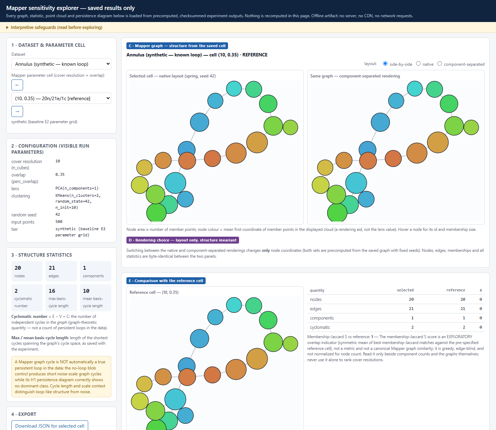

*Figure 7.1. The explorer on the annulus reference cell: point cloud, saved diagram, native and component-separated graph, structure statistics and the cycles-versus-loops notice.*

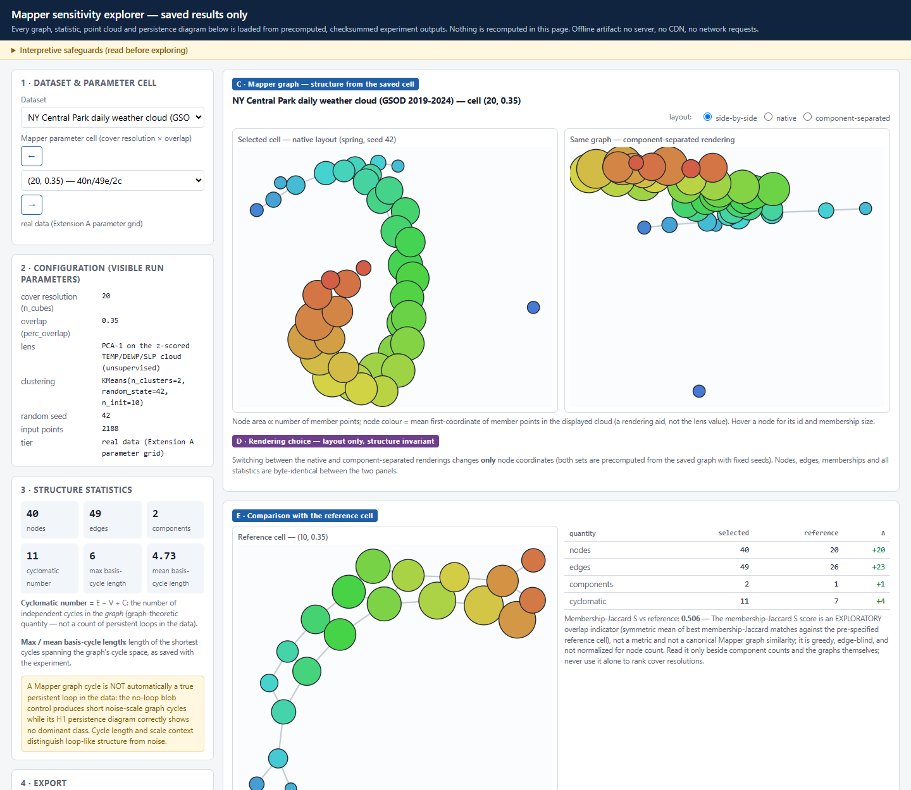

*Figure 7.2. The weather cell (20, 0.35): 40 nodes, 49 edges, 2 components, cyclomatic 11; differences against the reference cell and S = 0.506 beside its caveat. The right-hand panel shows the node overlap noted in Section 7.3.*

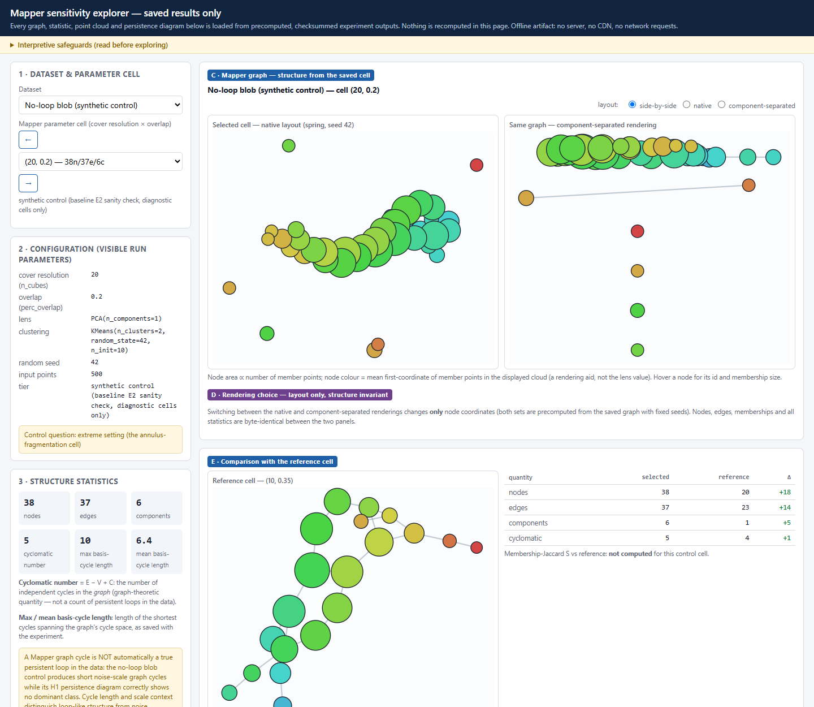

*Figure 7.3. The no-loop blob at (20, 0.20): 6 components and cyclomatic 5, while the H1 diagram shows no dominant class.*

## 8. Robustness under resampling

### 8.1 Design

Two variation axes are kept apart. *Parameter sensitivity* (E2, the weather grid, the explorer) varies Mapper parameters on fixed data. *Input-sampling stability* (this chapter) varies the sample and holds parameters fixed. Both analyses use the same design: 30 deterministic 80 % without-replacement subsamples (400 of 500 points) of each of the annulus, figure-eight and blob, seed rule `seed = 20261022 + offset + i`, indices stored per replicate. The seed rule regenerates all 90 stored index sets; persistence and Mapper use identical indices; each point appears 15–30 times (mean 24). The subsamples overlap the full-data reference, and the full-data cloud is itself one realisation of the generator (G1). [M]

### 8.2 Persistence-diagram resampling

Distances (persim 0.4.1) are computed per homology dimension against the full-data diagram, with H0 and H1 never pooled. The gap diagnostics use the ground-truth rank (r₁ for the annulus, r₂ for the figure-eight, r₁ as calibration only for the blob).

| Shape | Reference dominant H1 | Resample dominant H1 range | H1 bottleneck median (IQR) | Gap diagnostic over all 30 |
|---|---|---|---|---|
| annulus | 1.496 | 1.439 – 1.575 | 0.029 (0.023 – 0.051) | r₁ 13.2 – 25.6 (reference 19.3) |
| figure-eight | 0.481 | 0.458 – 0.511 | 0.019 (0.016 – 0.024) | r₂ 7.35 – 13.8 (reference 9.75) |
| blob (control) | 0.140 | 0.092 – 0.181 | 0.048 (0.044 – 0.053) | r₁ 1.00 – 1.75, 0 of 30 ≥ 3 |

The constructed loops are far above the noise floor in every subsample (r_k ≥ 7.35 in all 60 annulus and figure-eight replicates) and the blob never reaches 3. The median bottleneck distance relative to the reference dominant persistence is 1.9 % / 4.0 % / 34 % for annulus / figure-eight / blob; because the absolute medians (0.029, 0.019, 0.048) are all noise-scale and within a factor of 2.5 of one another, the ratios mainly reflect the different sizes of the reference features (1.496, 0.481, 0.140), and the percentages are descriptive only.

**Overlap with the reference (control D4).** Thirty independent redraws of each shape (seeds 777000 + i, n = 500) compared with the same seed-42 reference diagram give H1 bottleneck medians of 0.041 (annulus; IQR 0.033–0.050), 0.034 (figure-eight; 0.026–0.042) and 0.050 (blob; 0.048–0.057), against 0.029 / 0.019 / 0.048 for the overlapping subsamples: a factor of about 1.4 for the annulus and 1.8 for the figure-eight, and little for the blob. Across independent draws the annulus dominant H1 persistence is 1.447–1.587 (r₁ 11.6–21.8), the figure-eight 0.445–0.553 (r₂ 8.0–16.6) and the blob 0.078–0.157 (r₁ 1.00–1.64). A constructed loop is robustly present in every sample; the blob never shows a dominant class. [M]

**H0 cardinality (control D5).** Every 400-point subsample has 399 finite H0 classes against 499 for the reference. Each unmatched short class adds transport cost, so H0 Wasserstein values are inflated by the class-count difference — for replicate 0, 3.68 against the 500-point reference, 0.67 against another 400-point subsample — and must not be read as instability or compared in magnitude with H1 values. The H0 bottleneck is less affected but not unaffected (0.026 against the reference, 0.016 against another subsample). [M]

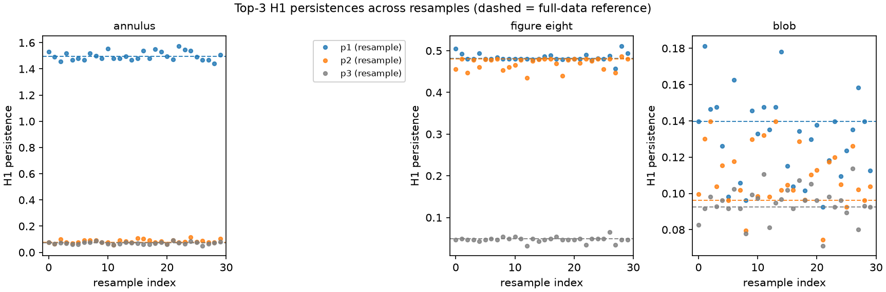

*Figure 8.1. Dominant-H1 persistence and gap diagnostics for the 30 resamples per shape against the full-data reference.*

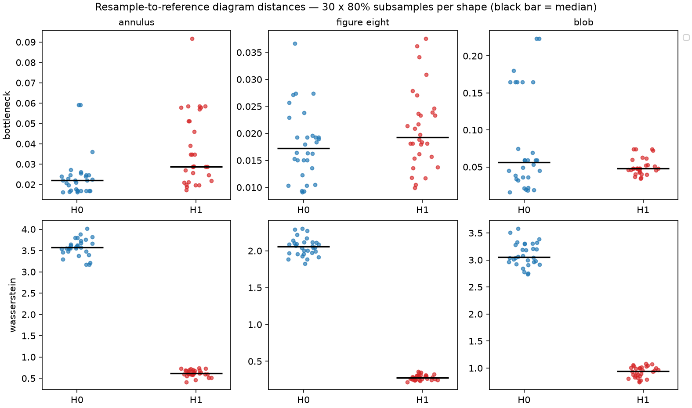

*Figure 8.2. Per-resample bottleneck and Wasserstein distances for H0 and H1 (all 90 subsamples). The H0 Wasserstein panel is inflated by the 399-versus-499 class-count difference; descriptive, G1 applies.*

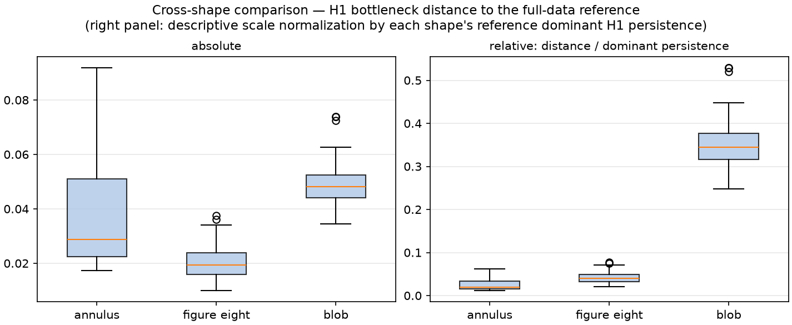

*Figure 8.3. Cross-shape H1 bottleneck distances, absolute and relative to the reference dominant persistence. The relative panel mostly reflects the denominators (Section 8.2).*

### 8.3 Mapper input-sampling stability and the clustering rule

With Mapper fixed at the reference configuration (10, 0.35, PCA-1 lens refit per subsample, KMeans k = 2), the 90 resampled graphs have 20 nodes each (mechanically, k = 2) and:

| Shape | Reference graph | Components over 30 | Cyclomatic over 30 | S vs reference, median (range) |
|---|---|---|---|---|
| annulus | 20 n, 21 e, 1 c, cyclomatic 2 | 1: 24, 2: 6 | 0: 13, 1: 9, 2: 8 | 0.585 (0.478 – 0.792) |
| figure-eight | 20 n, 19 e, 2 c, cyclomatic 1 | 2: 24, 1: 6 | 0: 12, 1: 18 | 0.762 (0.702 – 0.813) |
| blob | 20 n, 23 e, 1 c, cyclomatic 4 | 1: 10, 2: 12, 3: 8 | 1 – 6 | 0.645 (0.466 – 0.753) |

The count of subsamples without a cycle depends on the reference graph and on the seed set. The seed-42 annulus graph has cyclomatic number 2, whereas independent redraws of the annulus give 0 in 20 of 30, 1 in 7 and 2 in 3 under the same rule; a separate set of 30 fresh 80 % subsamples of the same cloud gave 18 / 8 / 4. The subsample counts therefore carry a binomial standard error of about 0.09 in the proportion. [M]

**Data-adaptive clustering (controls D3 and D4).** With single-linkage clustering at ε = 3.0 × the median 5-NN distance of the full cloud and everything else unchanged, the annulus graph has exactly one cycle in 30/30 subsamples and is connected in 29/30; the figure-eight has two cycles and one component in 30/30; the blob has no cycle in 27/30 but 7–12 components. With ε = 1.5 × that distance the annulus cycle cue is absent in 22/30 (components typically 4–6, range 1–10), the figure-eight has none in 30/30 (6–12 components) and the blob none in 29/30 (28–41 components). Over the independent redraws, ε = 3.0 gives one cycle and one component in 30/30 annulus draws, two cycles in 28/30 figure-eight draws (one in 2), and no cycle in 29/30 blob draws with 3–10 components; the forced two-cluster rule gives noise-scale cycles (cyclomatic 2–8) in all 30 blob draws. [M]

| Rule (annulus) | Cyclomatic over 30 subsamples | Cyclomatic over 30 independent redraws |
|---|---|---|
| KMeans k = 2 (default) | 0: 13, 1: 9, 2: 8 | 0: 20, 1: 7, 2: 3 |
| single-linkage, ε = 3.0 × d₅ | 1: 30 | 1: 30 |
| single-linkage, ε = 1.5 × d₅ | 0: 22, 1: 8 | not run |

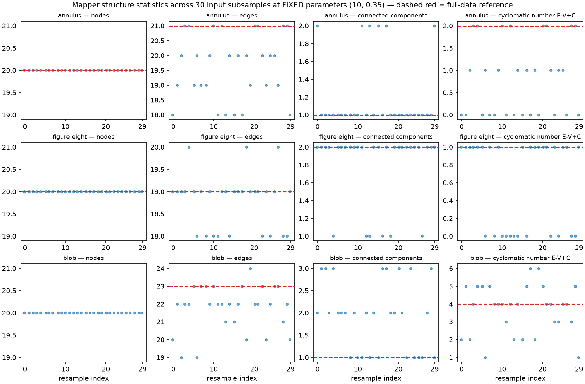

*Figure 8.4. Graph-structure statistics of the KMeans (k = 2) Mapper graphs over the 30 subsamples per shape: node count flat at 20; the annulus cycle cue and the blob's structure vary.*

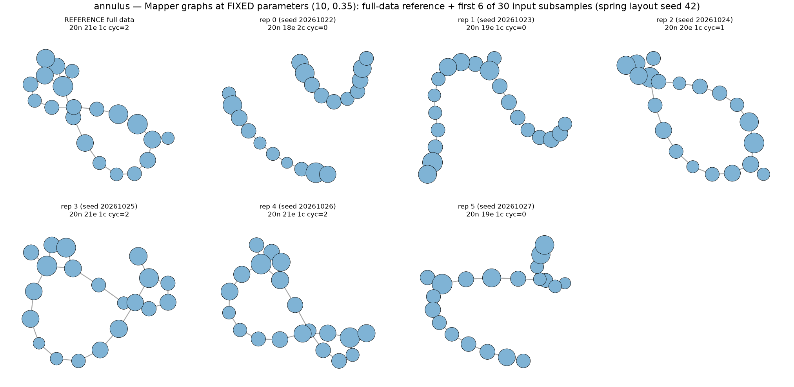

*Figure 8.5. Annulus Mapper graphs for the 30 resamples under the KMeans rule. The H1 loop is prominent in the persistence diagram of every one of these samples.*

**Interpretation [I].** The reliability of the Mapper cycle cue depends on the clustering rule and its scale: a forced split makes it unreliable and generates noise cycles on the blob; a moderately scaled data-adaptive rule makes it stable for the annulus and figure-eight; a smaller scale fragments the graph. A user cannot tell from the Mapper picture which regime they are in. The single-linkage scales were chosen after the KMeans result was known and only two were tried, so the stable result at ε = 3.0 is an existence demonstration that a defensible rule can preserve the cue; it is not a recommended setting or an independent confirmation of one. These results support the weaker statement that graph cycles and persistence loops are different kinds of evidence; they do not support a statement that diagrams are generally stable and graphs generally unstable.

The indicator S has a ceiling here: restricting the reference nodes to the sampled points already gives S = 0.800 (median; range 0.786–0.822), so the annulus median 0.585 is about 73 % of what sampling alone allows (the ceiling was measured for the annulus only, so the figure-eight and blob medians should be read with the same caveat).

### 8.4 Weather leave-one-year-out sensitivity

For each omitted calendar year the retained days are re-z-scored, and windows are built within contiguous retained blocks so that no window crosses the omitted year: 6 folds × 6 configurations = 36 embeddings. An independent re-computation of two folds with a separate year split and z-scoring reproduced the saved number of windows, dominant persistence and r₁ (omitting 2022 and 2020, τ = 73, d = 6: 1.885 / 5.748 and 1.432 / 4.954). r₁ ranges from 4.376 to 7.754 over the 36 fold-configurations (full-data range 4.75–7.32); the minimum occurs for the 2024 fold with τ = 73, d = 6. Dominant persistence is in retained-series z units and is comparable across folds only up to the retained standard deviation (8.77–9.11 °C); r₁ is invariant to that rescaling (embedding raw °C and z-scored data gives r₁ 4.744627 and 4.744628). [M]

**What the analysis can and cannot show.** In the 2020 and 2023 folds the retained single-year block (365 or 366 days) is shorter than or barely longer than the span and contributes at most 6 windows (none at all in 5 of the 10 affected fold-configurations), so omitting 2020 or 2023 effectively also omits the neighbouring year for those configurations: 10 of the 36 fold-configurations are not leave-one-year-out in effect. An annual harmonic explains 82 % of the series variance, so a dominant loop would be expected from any block of three or more years, and the 36 embeddings share four-sixths of the data pairwise and are not independent replicates. The analysis therefore shows only that no single year is needed for the cue; it is a sensitivity analysis, not a hypothesis test, a confidence interval, independent validation, or a statement about other climates. The null controls of Section 6.4 give the weather result its discriminating power. [I]

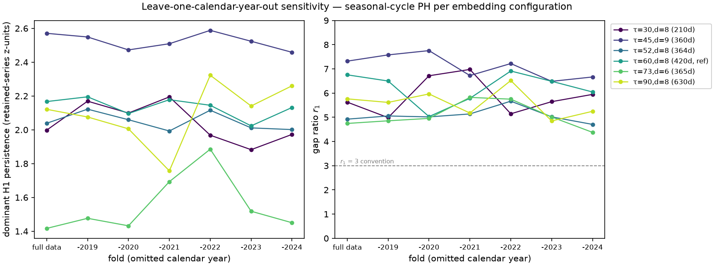

*Figure 8.6. Leave-one-calendar-year-out: dominant H1 persistence and r₁ per fold and configuration (36 embeddings), with the r₁ = 3 convention line. Folds in the middle of the series lose windows through the gap-safe rule.*

### 8.5 Runtimes and determinism

Cumulative H0 bottleneck computation dominates the persistence resampling (individual calls ranged 0.6–75 s; the matching in persim is strongly instance-dependent); the leave-one-year-out analysis takes about 4 minutes. Subsample indices, diagrams and graphs are deterministic given the seeds (Section 11).
## 9. Synthesis

### 9.1 Answers to the research questions

**RQ1 (workflow) [M].** The triad natively provides persistent homology, diagram plotting, diagram distances and matching plots, a static Mapper drawing and an interactive HTML export. It relies on custom code for generators, barcodes and the reproduction harness (130 counted lines), on scikit-learn for lens and clustering, and on networkx for component and cycle counts. The interactive export does not work offline (Section 7.2). The ecosystem is a partial visualization system: strong on computing and on primary encodings, thin on the interpretive layer that tells a viewer what a feature is worth, and without a view of how a Mapper graph changes across parameters.

**RQ2 (sensitivity) [M].** Cover resolution, overlap, and the clusterer rule and scale all change the structural story a Mapper graph tells — tree, one cycle, two cycles, or fragments. In the default configuration, which forces two clusters per cover interval, the figure-eight fragments at the reference cell and the no-loop blob shows noise cycles; with a data-adaptive clusterer at one scale the figure-eight is connected with two cycles and the blob has almost none but is split into many components. The explorer makes the dependence inspectable offline with provenance for the saved cells; it recomputes nothing and covers one clusterer.

**RQ3 (what the artifacts communicate) [I].** Diagrams make a dominant loop apparent when it exists, and an essential H0 point and unlabeled colours can mislead a reader; Mapper graphs make cycles and fragments salient whether or not they correspond to loops in the data; native layouts can overlap components. This rests on a single, invested observer with AI viewing assistance and says nothing about how people read these figures.

**Weather study [M, I].** A sliding-window embedding of a six-year daily temperature series yields a dominant H1 class in all six tested configurations; the matched null controls do not meet the same dominance criterion; the cue therefore depends on the annual harmonic structure and on temporal order in this series. The Mapper view of the static three-feature cloud adds a graph whose cycles and fragmentation are parameter-dependent.

**Resampling [M].** The persistence evidence for the constructed loops is present in every subsample and independent redraw, and its magnitude varies by a few percent of the feature scale. The reliability of the Mapper cycle cue depends on the clusterer and its scale.

### 9.2 Three dependent variables, three sets of inputs

A persistence-diagram feature, a Mapper-graph feature and a rendered appearance are different dependent variables with different inputs. The diagram feature depends on the data and the filtration (here Vietoris–Rips on Euclidean distance). The graph feature additionally depends on the lens, the cover, the clusterer and its scale; in these experiments the clusterer choice changes the feature as much as any other input. The picture depends on the layout and the encodings, and a layout can hide components without changing the graph. The operational recommendation is to ask of any topological picture which of these it is, and to look at the parameters it depends on. The experiments do not support a claim that people often confuse graph cycles with persistent-homology loops; no study of people exists here. They show that the two kinds of evidence are not interchangeable: no-loop data produce graph cycles under one clusterer and almost none under another, and loop data produce one cycle, none, or a fragmented graph depending on the same inputs, while the diagram's dominant class stays in place.

### 9.3 What the evidence does not establish

No independent validation (G1); no confidence sets or hypothesis tests (G2); nothing about other stations, variables, decades or climate change; no cross-implementation check of ripser; nothing about human readability; no ranking of Mapper against PCA, t-SNE or UMAP; no claim that the custom indicators r_k and S are canonical; and no general claim about Mapper, because every Mapper result is for one lens (PCA-1), one cover family and two clusterer families, on two-dimensional synthetic data and one weather cloud.

## 10. Limitations, threats to validity and non-claims

### 10.1 Limitations and failure modes

- **Graph cycle cues are conditional on the clusterer** (Section 8.3): forced two-way splits create noise cycles (all 30 blob draws) and can remove real ones; a small scale fragments the graph.
- **Node count is uninformative** in every KMeans k = 2 result, by construction.
- **Fragmentation can look like structure**, and a native layout can hide it.
- **Descriptive distances have structural caveats.** H0 Wasserstein is inflated by cardinality; overlapping subsamples understate variability by about 1.4–1.8 for the annulus and figure-eight.
- **Custom indicators need their caveats.** The threshold of r_k is a convention; S is edge-blind and has a sampling ceiling of about 0.80 at 400 of 500 points.
- **Temporal data resist naive resampling.** Leave-one-year-out is a sensitivity analysis with limited power (Section 8.4).
- **Single-observer, AI-assisted inspection** (E3) and one-browser testing of the explorer.

### 10.2 Threats to validity

- *Construct validity.* r_k ≥ 3 and the Mapper cyclomatic number are operational stand-ins for "a prominent loop" and "a loop cue"; neither is a theorem, and "dominant H1" means exactly r_k ≥ 3.
- *Internal validity.* One data seed per shape; one lens; the ground-truth rank is supplied to the gap diagnostic; only two clusterer scales were tried and they were chosen with the default-rule results in view; the reference graph of the resampling analysis is one realisation.
- *External validity.* Two-dimensional synthetic shapes; one station, six years; no other topology (tori, spheres), no high-dimensional data, no outliers, no noise sweep, no comparison with other implementations.
- *Conclusion validity.* No p-values or intervals are used. Counts over 30 subsamples have a binomial standard error of about 0.09 in the proportion.
- *Researcher degrees of freedom.* Several choices were made knowing the data (Section 10.3).

### 10.3 Order of design and analysis

Contemporaneous version-control history was not maintained during the project. The submission repository is organized retrospectively for reproducibility and release; its commit history should not be interpreted as evidence of the original design or analysis chronology. No independent time stamps exist either, so the order in which choices were made rests on the project records and cannot be verified from artifacts.

| Item | Status |
|---|---|
| Ground-truth ranks per shape; r_k ≥ 3 convention; 30 × 80 % design and seed rule; E2 grid and reference cell; weather reference (τ, d) = (60, 8) | Recorded in design documents or configuration before the corresponding run, per the project records; not independently time-stamped |
| The other five embedding configurations | Designed to bracket the annual period, knowing it; not a null and not independent |
| Seasonality check (FFT, ACF) and its [180, 550] d and [30, 800] d windows | Post hoc: written after the sweep; not pre-specified |
| E2 figure-eight contrast cell (20, 0.50) | Chosen after the full grid was measured |
| Controls D1–D5 and their parameters, including the two clusterer scales | Written to `controls.yaml` before each script's first run but after the default-configuration results were known; exploratory choices |

### 10.4 Non-claims

This study does not claim: a participant study; any statement about human accuracy or population-level readability; a new algorithm or metric; that S or r_k is canonical; that the explorer is the first Mapper explorer; a climate result, a causal claim or a trend; that a Mapper cycle proves a loop or that a missing cycle disproves one; that a persistence feature proves the true topology of the data; that Mapper is better or worse than PCA, t-SNE or UMAP; or that the sensitivity analyses are tests, intervals or validation.

## 11. Computational setup and verification

### 11.1 Setup

All experiments use Python 3.12 with the pinned packages ripser 0.6.15, persim 0.4.1, kmapper 2.1.0, tadasets 0.2.2, scikit-learn 1.9.1, numpy 2.5.4, scipy 1.18.1, matplotlib 3.11.2, networkx 3.7, pyyaml 6.0.3 and pytest 8.4.2. The results were computed on Linux (Python 3.12.15) and re-executed independently in a clean environment on Windows 11 (Python 3.12.13; `PYTHONUTF8=1`). The package freeze, environment record, seeds, raw logs, hashes and step-by-step reproduction instructions are in the technical package (`technical/verification/` and `README.md`); macOS and other Linux distributions were not tested. The code, data, results, tests and verification scripts are published at <https://github.com/shouryasarkar713/when-can-you-trust-a-topological-visualization>; the repository's commit history was constructed retrospectively and records neither the original chronology nor any review (Section 10.3).

### 11.2 Agreement between the two platforms

Text outputs were compared after newline normalisation, JSON by parsed content (wall-clock fields excluded), arrays element by element and figures pixel by pixel. Core experiments (results, audit, E3, figures, configurations): 64 files identical, 34 figures pixel-identical, 3 differ; weather study: 30 files identical, 12 figures pixel-identical, 3 differ; resampling study: 15 files identical, 9 figures pixel-identical, 0 differ; explorer: 11 files identical, 3 differ; control experiments: 5 files identical. The differences are: the annulus and figure-eight clouds differ by at most 2.2·10⁻¹⁶ (the trigonometric library differs by one unit in the last place between platforms; blob and three-blob clouds are bit-identical); the wall-clock stage times in the E1 audit file; linear-algebra round-off of at most 8.9·10⁻¹⁵ in the weather PCA coordinates and embedding; a recorded hash of an array archive (zip metadata); and, in the explorer, hashes and byte counts of source files that Windows writes with CRLF line endings (parsed content identical). All persistence diagrams, result files, graphs and counts agree. Timing, PNG bytes, line endings and the hashes that depend on them are platform-dependent by nature.

### 11.3 Tests and checks

| Suite | Result |
|---|---|
| Core experiments (`tests`; includes 14 isolation and runner regression tests) | 86 passed |
| Weather study (`extensions/meteorology/tests`) | 44 passed |
| Explorer (`extensions/mapper_explorer/tests`; includes repository-unchanged regression tests) | 23 passed |
| Resampling study (`extensions/stability/tests`) | 29 passed |
| Control experiments (`extensions/controls/tests`) | 10 passed |

In total 192 passed, 0 failed, 0 skipped, run by a single command (`python scripts/run_all_tests.py`) that also verifies the environment (38 of 38 assertions), the manifest of the preserved core results immediately after the suites (128 of its 145 files are distributed and byte-identical; 17 are intentionally not distributed — 16 original course-report files and the original `.gitignore` — and are listed with hashes and reasons in `BASELINE_RELEASE_EXCLUSIONS.json`), the evidence verifier and, on request, the offline browser test of the explorer. The runner writes its logs to a temporary directory, hashes the whole tree before and after, and returns a non-zero exit status on any failure, missing suite, suite that could not execute (for example a missing dependency), unexpected change to the tree, or skipped test. Tests never write into the repository: the explorer builder takes an `--out-dir` option that the determinism test uses, a repository-wide guard in `conftest.py` fails and reverts any test that changes a file, and regression tests cover both guarantees. The evidence verifier re-derives the numbers of this report from the result files and checks them against the Markdown, DOCX and PDF editions, the slides and the Q&A.

## 12. Conclusions and future work

**Answers.** The triad natively covers computation, diagram plotting, diagram distances and a static Mapper drawing; barcodes, generators, graph statistics, the reproduction harness and offline use of the interactive export need other code or other packages. The structural story of a Mapper graph depends on cover resolution, overlap, clusterer rule and clusterer scale. The inspected figures make apparent what they were built to show and can mislead through unlabeled colours, the essential H0 point and noise-scale cycles, according to a single AI-assisted observer.

**Central claim.** A persistence-diagram feature, a Mapper-graph feature and a drawing are different dependent variables with different inputs. On known-answer data and one weather series, the persistent H1 evidence for a constructed loop is present in every tested subsample and redraw; the dominant H1 cue of the weather embedding depends on the annual harmonic structure and on temporal order under the matched controls; and the Mapper cycle cue ranges from stable to absent to fragmented depending on the clusterer and its scale, without the picture revealing which. Trust in a topological visualization should therefore follow its construction: which representation carries the claim, which parameters it depends on, and which null control it has to beat.

**What would change the conclusions.** A disagreement between ripser and a second implementation on the key diagrams; another data seed or shape family in which the data-adaptive clusterer also fails; surrogate nulls (phase-randomised, autoregressive, nonlinear seasonal) that reproduce the dominant weather cue; or participant data that contradict the artifact-level observations.

**Future work [F].** (1) Add a clusterer-scale dimension to the explorer and a sweep over cover and scale with surrogate nulls. (2) Cross-check ripser against GUDHI on the key diagrams. (3) Add a second station with a contrasting climate, and a time-series bootstrap with window-aware constraints. (4) Develop a graph distance for Mapper stability on a principled footing (in the spirit of Carrière & Oudot, Brown et al. and Belchí et al.). (5) With appropriate design and approval, a participant study with counterbalanced orders and a registered analysis plan; until then no claim about readers.

## 13. References

Entries marked † were consulted at abstract or program-page level only.

- Bauer, U. (2021). Ripser: Efficient computation of Vietoris–Rips persistence barcodes. *Journal of Applied and Computational Topology, 5*(3), 391–423. https://doi.org/10.1007/s41468-021-00071-5
- Belchí, F., Brodzki, J., Burfitt, M., & Niranjan, M. (2020). A numerical measure of the instability of Mapper-type algorithms. *Journal of Machine Learning Research, 21*(202), 1–45. https://www.jmlr.org/papers/v21/19-540.html
- Brehmer, M., & Munzner, T. (2013). A multi-level typology of abstract visualization tasks. *IEEE Transactions on Visualization and Computer Graphics, 19*(12), 2376–2385. https://doi.org/10.1109/TVCG.2013.124
- Brown, A., Bobrowski, O., Munch, E., & Wang, B. (2021). Probabilistic convergence and stability of random Mapper graphs. *Journal of Applied and Computational Topology, 5*, 99–140. https://doi.org/10.1007/s41468-020-00063-x
- Carrière, M., Michel, B., & Oudot, S. (2018). Statistical analysis and parameter selection for Mapper. *Journal of Machine Learning Research, 19*(12), 1–39. https://www.jmlr.org/papers/v19/17-291.html
- Carrière, M., & Oudot, S. (2018). Structure and stability of the one-dimensional Mapper. *Foundations of Computational Mathematics, 18*(6), 1333–1396. https://doi.org/10.1007/s10208-017-9370-z
- Cohen-Steiner, D., Edelsbrunner, H., & Harer, J. (2007). Stability of persistence diagrams. *Discrete & Computational Geometry, 37*(1), 103–120. https://doi.org/10.1007/s00454-006-1276-5
- Edelsbrunner, H., Letscher, D., & Zomorodian, A. (2002). Topological persistence and simplification. *Discrete & Computational Geometry, 28*(4), 511–533. https://doi.org/10.1007/s00454-002-2885-2
- Isenberg, T., Isenberg, P., Chen, J., Sedlmair, M., & Möller, T. (2013). A systematic review on the practice of evaluating visualization. *IEEE Transactions on Visualization and Computer Graphics, 19*(12), 2818–2827. https://doi.org/10.1109/TVCG.2013.126
- Lam, H., Bertini, E., Isenberg, P., Plaisant, C., & Carpendale, S. (2012). Empirical studies in information visualization: Seven scenarios. *IEEE Transactions on Visualization and Computer Graphics, 18*(9), 1520–1536. https://doi.org/10.1109/TVCG.2011.279
- Maria, C., Boissonnat, J.-D., Glisse, M., & Yvinec, M. (2014). The Gudhi library: Simplicial complexes and persistent homology. In H. Hong & C. Yap (Eds.), *Mathematical Software — ICMS 2014* (Lecture Notes in Computer Science, Vol. 8592, pp. 167–174). Springer. https://doi.org/10.1007/978-3-662-44199-2_28
- Munzner, T. (2009). A nested model for visualization design and validation. *IEEE Transactions on Visualization and Computer Graphics, 15*(6), 921–928. https://doi.org/10.1109/TVCG.2009.111
- Muszynski, G., Kashinath, K., Kurlin, V., Wehner, M., & Prabhat. (2019). Topological data analysis and machine learning for recognizing atmospheric river patterns in large climate datasets. *Geoscientific Model Development, 12*(2), 613–628. https://doi.org/10.5194/gmd-12-613-2019
- NOAA National Centers for Environmental Information. *Global Summary of the Day (GSOD)*. https://www.ncei.noaa.gov/data/global-summary-of-the-day/ (accessed 28 October 2026).
- NOAA Physical Sciences Laboratory. *Oceanic Niño Index (ONI)*, derived from NOAA Climate Prediction Center; ERSST v6 as of 7 September 2026. https://psl.noaa.gov/data/correlation/oni.data (accessed 28 October 2026).
- Nielsen, J. (1992). Finding usability problems through heuristic evaluation. In *Proceedings of CHI '92* (pp. 373–380). ACM. https://doi.org/10.1145/142750.142834 (cited by analogy for single-inspector limits only).
- Perea, J. A., Deckard, A., Haase, S. B., & Harer, J. (2015). SW1PerS: Sliding windows and 1-persistence scoring; discovering periodicity in gene expression time series data. *BMC Bioinformatics, 16*, 257. https://doi.org/10.1186/s12859-015-0645-6
- Perea, J. A., & Harer, J. (2015). Sliding windows and persistence: An application of topological methods to signal analysis. *Foundations of Computational Mathematics, 15*(3), 799–838. https://doi.org/10.1007/s10208-014-9206-z
- Saul, N., & Tralie, C. (2019). *Scikit-TDA: Topological data analysis for Python* [Software]. Zenodo. https://doi.org/10.5281/zenodo.2533369 (as prescribed by the package README).
- Sedlmair, M., Heinzl, C., Bruckner, S., Piringer, H., & Möller, T. (2014). Visual parameter space analysis: A conceptual framework. *IEEE Transactions on Visualization and Computer Graphics, 20*(12), 2161–2170. https://doi.org/10.1109/TVCG.2014.2346321
- Sen, A., Singh, S., & Tiwari, S. P. (2026). A three axis evaluation framework for Mapper algorithms. *arXiv:2606.21688*. https://arxiv.org/abs/2606.21688 †
- Simi, L. (2025). *tda-mapper* (Version 0.12.0) [Computer software]. https://github.com/lucasimi/tda-mapper-python
- Singh, G., Mémoli, F., & Carlsson, G. (2007). Topological methods for the analysis of high dimensional data sets and 3D object recognition. In *Eurographics Symposium on Point-Based Graphics (SPBG 2007)* (pp. 91–100). Eurographics Association. https://doi.org/10.2312/SPBG/SPBG07/091-100
- Strommen, K., Chantry, M., Dorrington, J., & Otter, N. (2023). A topological perspective on weather regimes. *Climate Dynamics, 60*(5–6), 1415–1445. https://doi.org/10.1007/s00382-022-06395-x
- Tauzin, G., Lupo, U., Tunstall, L., Burella Pérez, J., Caorsi, M., Medina-Mardones, A. M., Dassatti, A., & Hess, K. (2021). giotto-tda: A topological data analysis toolkit for machine learning and data exploration. *Journal of Machine Learning Research, 22*(39), 1–6. https://www.jmlr.org/papers/v22/20-325.html
- Tralie, C., Saul, N., & Bar-On, R. (2018). Ripser.py: A lean persistent homology library for Python. *Journal of Open Source Software, 3*(29), 925. https://doi.org/10.21105/joss.00925
- van Veen, H. J., Saul, N., Eargle, D., & Mangham, S. W. (2019). Kepler Mapper: A flexible Python implementation of the Mapper algorithm. *Journal of Open Source Software, 4*(42), 1315. https://doi.org/10.21105/joss.01315
- Yan, X., Li, J., & Wang, B. (2026). LoCoMapper: Local structural uncertainty analysis of Mapper graphs under cover perturbations. *IEEE VIS 2026 Workshop on Uncertainty Visualization* (Honorable Mention). Program page: https://am.ieeevis.org/year/2026/program/content/9e4af3b5-5f6d-4b27-ba09-7ea919068da0 †
- Zhou, Y., Chalapathi, N., Rathore, A., Zhao, Y., & Wang, B. (2021). Mapper Interactive: A scalable, extendable, and interactive toolbox for the visual exploration of high-dimensional data. In *2021 IEEE 14th Pacific Visualization Symposium (PacificVis)* (pp. 101–110). IEEE. https://doi.org/10.1109/PacificVis52677.2021.00021
- Zomorodian, A., & Carlsson, G. (2005). Computing persistent homology. *Discrete & Computational Geometry, 33*(2), 249–274. https://doi.org/10.1007/s00454-004-1146-y

## Appendix A. Experimental configurations

| Experiment | Data | Method and parameters |
|---|---|---|
| E1 | annulus, figure-eight, blob (n = 500), three blobs (n = 450); seed 42 | 13-task scripted workflow; ripser `maxdim = 1`; `CubicalCover(n_cubes = 10, perc_overlap = 0.35)`, PCA-1 lens, `KMeans(2, random_state = 42, n_init = 10)` |
| E2 | annulus, figure-eight (n = 500, noise 0.05, seed 42); blob (σ = 0.45) at two cells | `n_cubes` ∈ {5, 10, 15, 20} × `perc_overlap` ∈ {0.20, 0.35, 0.50}; reference (10, 0.35); same lens and clusterer |
| E3 | 13 stimuli rendered from saved results | structured single-observer inspection; five task types; expected properties fixed from the construction |
| Weather study | GSOD station 72505394728, 2019–2024; 2188 days (TEMP, DEWP, SLP) for the cloud, 2192 days of TEMP for embeddings | PCA; Mapper grid {5, 10, 15, 20} × {0.35, 0.50}; sliding-window embeddings (τ, d) ∈ {(30, 8), (45, 9), (52, 8), (60, 8), (73, 6), (90, 8)}, stride 1, ripser `maxdim = 1` |
| Resampling study | annulus, figure-eight, blob; 30 subsamples of 400 of 500 points per shape | seed rule above; persim bottleneck and Wasserstein (essential H0 class dropped); Mapper at (10, 0.35); leave-one-year-out: 6 folds × 6 configurations |
| D1 | as E2 | single-linkage, ε = c × median 5-NN distance, c ∈ {1.5, 3.0}; 12-cell grid |
| D2 | weather TEMP series | anomaly series (intercept and two annual harmonic pairs removed by least squares); 10 shuffled series (seeds 20261028 + i), reference configuration |
| D3 | as the resampling study | the 30 subsamples with the D1 clusterer at (10, 0.35) |
| D4 | 30 new 500-point draws per shape (seeds 777000 + i) | H1 bottleneck to the seed-42 reference diagram; Mapper cycle cue with KMeans and single-linkage (c = 3.0) |
| D5 | annulus subsamples of the resampling study | S ceiling; H0 Wasserstein and bottleneck with matched cardinality |
